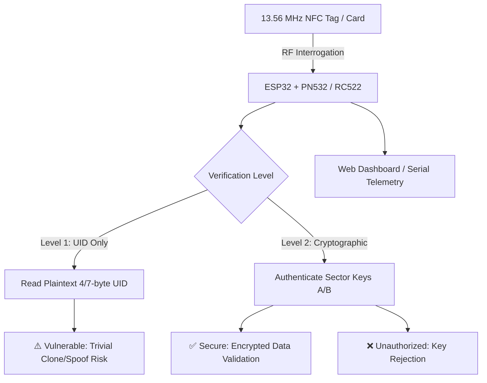

# ESP32 NFC Security & Vulnerability Analysis

[](https://www.espressif.com/)
[](#hardware-architecture)
[](#hardware-architecture)
[](docs/Ethics_&_Scope.md)
[](#license)

An embedded security research framework running on the **ESP32** microcontroller for auditing **13.56 MHz RFID/NFC** access control architectures. This project contrasts the vulnerabilities of unauthenticated Unique Identifier (UID) verification against cryptographic sector-authenticated access control.

---

## Table of Contents

- [Overview](#overview)
- [Key Objectives](#key-objectives)
- [Vulnerability Scope & Comparison](#vulnerability-scope--comparison)
- [Hardware Architecture & Pinout](#hardware-architecture--pinout)
- [Repository Structure](#repository-structure)
- [Ethics & Academic Scope](#ethics--academic-scope)
- [Getting Started](#getting-started)
- [Roadmap](#roadmap)
- [Contributing & License](#contributing--license)

---

## Overview

Many commercial and institutional access control systems rely solely on reading the **Card UID** (Unique Identifier) transmitted in plaintext during ISO/IEC 14443A anti-collision loops. Because UID-based verification requires no cryptographic authentication, these systems are vulnerable to:

- **UID Spoofing**: Simulating a target UID using programmable cards (e.g., "Magic" Gen1a / Gen2 cards) or microcontrollers.
- **Eavesdropping & Replay**: Intercepting over-the-air UID transmissions and replaying them.

This project implements a testbed to evaluate these attack surfaces on controlled lab tags, while demonstrating secure countermeasures using authenticated cryptographic sectors (e.g., MIFARE Classic Key A/B validation, AES/DES authentication).



---

## Key Objectives

1. **Card Interrogation & Identification**:
   - Detect and extract ATQA (Answer to Request Type A), SAK (Select Acknowledge), and UID (4-byte single size or 7-byte double size).
   - Identify tag IC family (MIFARE Classic 1K/4K, Ultralight, NTAG21x, DESFire).

2. **Vulnerability Demonstration**:
   - Contrast trivial UID spoofing against cryptographic challenge-response access control.
   - Evaluate susceptibility to dictionary attacks across common sector keys.

3. **Telemetry & Live Web Dashboard**:
   - Provide real-time audit logs and access attempt telemetry via an embedded web server hosted on the ESP32 (served from SPIFFS/LittleFS).

4. **Simulation & Offline Validation**:
   - Support Wokwi virtual simulation for rapid firmware iteration without immediate physical hardware.

---

## Vulnerability Scope & Comparison

| Access Paradigm | Data Evaluated | Security Level | Attack Vectors | Recommended Mitigation |
| :--- | :--- | :--- | :--- | :--- |
| **UID-Only Access** | 4-byte or 7-byte UID | 🔴 **Low** (Insecure) | UID spoofing, Magic card cloning, Replay | Require authenticated data blocks |
| **MIFARE Classic (Crypto-1)** | Sector trailer keys (Key A / Key B) | 🟡 **Medium** (Legacy) | Nested attack, Darkside attack, Hardnested | Upgrade to DESFire or AES-based tags |
| **Encrypted Sector (AES/DES)** | Challenge-response authentication | 🟢 **High** (Modern) | Resistant to cloning without hardware extraction | Rotate master keys; enable CMAC |

---

## Hardware Architecture & Pinout

### Recommended Components

- **MCU**: ESP32 Development Board (ESP-WROOM-32 / NodeMCU-32S)
- **NFC Transceiver**: NXP **PN532** (recommended for full read/write/emulation support) or **MFRC522** (SPI)
- **Test Credentials**: Blank MIFARE Classic 1K cards, CUID/UID-changeable tags, NTAG213/215 stickers

### Default Pinout Configuration (ESP32 to PN532 via SPI)

| PN532 Pin | ESP32 GPIO | Description |
| :--- | :--- | :--- |
| **SCK** | `GPIO 18` | SPI Clock |
| **MISO** | `GPIO 19` | Master In Slave Out |
| **MOSI** | `GPIO 23` | Master Out Slave In |
| **SS / CS** | `GPIO 5` | Chip Select |
| **RSTPD_N**| `GPIO 22` | Reset / Power Down |
| **IRQ** | `GPIO 4` | Interrupt Request |
| **VCC** | `3.3V` / `5V` | Regulated DC Power |
| **GND** | `GND` | Ground Reference |

> **Note**: If using I2C for PN532, connect `SDA` to `GPIO 21`, `SCL` to `GPIO 22`, and ensure dip switches are configured for I2C mode.

---

## Repository Structure

```text
esp32-nfc/
├── docs/
│   └── Ethics_&_Scope.md          # Formal research boundaries and ethical constraints
├── firmware/
│   ├── esp32-nfs-system/          # Core ESP32 firmware source code
│   │   ├── data/                  # Static assets (HTML/CSS/JS) for SPIFFS/LittleFS web server
│   │   └── src/                   # C++ / Arduino / ESP-IDF source files
│   └── platformio.ini             # PlatformIO build configuration & dependencies
├── simulation/                    # Wokwi simulation configurations and mock scenarios
└── README.md                      # Project documentation and setup guide
```

---

## Ethics & Academic Scope

> [!IMPORTANT]
> This project is conducted strictly as an **academic vulnerability analysis** under safe, responsible disclosure principles.

- **Controlled Lab Environment**: All tests and experiments are strictly limited to self-provisioned, lab-owned, or blank test cards.
- **No Unauthorized Testing**: Under no circumstances should this system or code be used against live institutional infrastructure, university turnstiles, hostel doors, public transit, or third-party facilities.
- Detailed ethics guidelines are documented in [docs/Ethics_&_Scope.md](docs/Ethics_&_Scope.md).

---

## Getting Started

### Prerequisites

- [Visual Studio Code](https://code.visualstudio.com/) with the [PlatformIO IDE Extension](https://platformio.org/) (or Arduino IDE 2.x with ESP32 board support)
- Git installed on your local machine

### Installation & Flashing

1. **Clone the repository**:
   ```bash
   git clone https://github.com/rajveermodi/esp32-nfc.git
   cd esp32-nfc
   ```

2. **Open the project in PlatformIO**:
   Open the `firmware/` directory inside VS Code PlatformIO.

3. **Install Dependencies**:
   PlatformIO will automatically resolve the required libraries:
   - `adafruit/Adafruit-PN532` (or `miguelbalboa/MFRC522`)
   - `ESP Async WebServer` & `AsyncTCP` (for Web Dashboard)
   - `bblanchon/ArduinoJson`

4. **Upload Firmware and Filesystem**:
   - Build and upload firmware:
     ```bash
     pio run --target upload
     ```
   - Upload web dashboard assets to SPIFFS/LittleFS:
     ```bash
     pio run --target uploadfs
     ```

5. **Monitor Logs**:
   ```bash
   pio device monitor --baud 115200
   ```

---

## Roadmap

- [x] Scope definition and ethical framework establishment
- [ ] Core ISO 14443A card reader module with ATQA/SAK parsing
- [ ] UID cloning vs. Cryptographic Sector Authentication test suite
- [ ] Embedded Web Dashboard interface on ESP32 (LittleFS-backed)
- [ ] Wokwi simulation diagram for hardware-free development and automated tests
- [ ] Documentation on mitigation strategies for access-control system administrators
