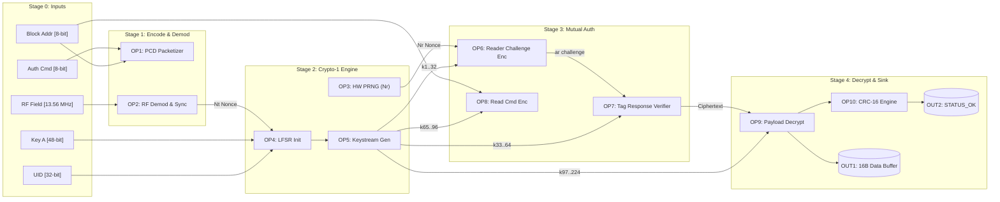

# Data Flow Graphs (DFG) & Control Data Flow Graphs (CDFG)
## Project: ESP32 13.56 MHz RFID/NFC Security & Vulnerability Analysis
**Course Deliverable:** BACSE324 Review 2 System Architecture Models  
**Diagram Format:** Native Draw.io (`.drawio`) & Standalone Vector SVG (`.svg`)

---

## 1. Overview of Artifacts & Quick Links

All models have been generated into the [`docs/diagrams/`](file:///Users/rajveermodi/Documents/GitHub/esp32-nfc/docs/diagrams) directory in two formats:
1. **Interactive Multi-Page Draw.io Master File**: Contains all 4 models organized as tabs.
2. **Individual Draw.io Files**: For modular editing and standalone imports.
3. **High-Resolution Vector SVG Files**: For direct embedding into reports, presentations, and markdown documents.

| Model Name | Type | Purpose | Draw.io File | Vector SVG |
| :--- | :--- | :--- | :--- | :--- |
| **All Models (Master)** | Multi-Page | Complete 4-page tabbed diagram suite | [esp32_nfc_complete_models.drawio](file:///Users/rajveermodi/Documents/GitHub/esp32-nfc/docs/diagrams/esp32_nfc_complete_models.drawio) | — |
| **Model 1: Crypto Auth & Read** | DFG (Data Flow) | Critical-path mathematical operations & bit-widths | [dfg_crypto_auth.drawio](file:///Users/rajveermodi/Documents/GitHub/esp32-nfc/docs/diagrams/dfg_crypto_auth.drawio) | [dfg_crypto_auth.svg](file:///Users/rajveermodi/Documents/GitHub/esp32-nfc/docs/diagrams/dfg_crypto_auth.svg) |
| **Model 2: System Telemetry** | DFG (Data Flow) | Latency benchmark, JSON serializing & LittleFS flush | [dfg_system_telemetry.drawio](file:///Users/rajveermodi/Documents/GitHub/esp32-nfc/docs/diagrams/dfg_system_telemetry.drawio) | [dfg_system_telemetry.svg](file:///Users/rajveermodi/Documents/GitHub/esp32-nfc/docs/diagrams/dfg_system_telemetry.svg) |
| **Model 3: Critical Function** | CDFG | Control decisions, error fallbacks, and data operands | [cdfg_authenticate_and_read.drawio](file:///Users/rajveermodi/Documents/GitHub/esp32-nfc/docs/diagrams/cdfg_authenticate_and_read.drawio) | [cdfg_authenticate_and_read.svg](file:///Users/rajveermodi/Documents/GitHub/esp32-nfc/docs/diagrams/cdfg_authenticate_and_read.svg) |
| **Model 4: System Main Loop** | CDFG | Dual-mode security engine (Level 1 vs Level 2) | [cdfg_system_main_loop.drawio](file:///Users/rajveermodi/Documents/GitHub/esp32-nfc/docs/diagrams/cdfg_system_main_loop.drawio) | [cdfg_system_main_loop.svg](file:///Users/rajveermodi/Documents/GitHub/esp32-nfc/docs/diagrams/cdfg_system_main_loop.svg) |

---

## 2. Theoretical Distinction: DFG vs. CDFG

In embedded systems architecture and hardware-software co-design:

- **Data Flow Graph (DFG):**
  - An acyclic directed graph $G = (V, E)$ where vertices $V$ represent pure computational transformations (e.g., bitwise LFSR shifts, XOR encryption, CRC-16 polynomial evaluation, timing subtraction) and directed edges $E$ represent data tokens, registers, and memory buffers passed between operations.
  - **Zero control logic**: No branching (`if`/`else`), loops, or conditional path selection.
  - Highlights data concurrency, critical paths, and register width dependencies.

- **Control Data Flow Graph (CDFG):**
  - An extended graph model integrating both **Control Flow** (sequencing, conditional branching, timeouts, loops, error recovery) and **Data Flow** (data operands and buffers consumed/produced by computational states).
  - Explicitly models decision conditions (e.g., $C_1$: Handshake Ack?, $C_2$: Mutual Auth Valid?, $C_3$: CRC Valid?), failure traps, and hardware interface states alongside data dependencies.

---

## 3. Model 1: DFG — Cryptographic Authentication & Block Read (Critical Path)

### Scope & Critical Path
Models the atomic execution of `authenticate_and_read_block()` on Sector 1, Block 4.  
- **Worst-Case Execution Time ($T_{\text{exec}}$):** $28,500\,\mu\text{s}$
- **Real-Time RF Deadline ($D$):** $35,000\,\mu\text{s}$
- **Slack Time ($S = D - T_{\text{exec}}$):** $6,500\,\mu\text{s}$ (18.6% margin)

### Pipeline Stages & Node Breakdown
1. **Stage 0: Input Operands & Hardware Registers**
   - `IN_KEY`: Secret Key A Register (48-bit: `0xFF 0xFF 0xFF 0xFF 0xFF 0xFF`)
   - `IN_BLOCK`: Target Block Address (8-bit: `0x04` - Sector 1, Block 0)
   - `IN_UID`: Tag UID Register (32-bit: `rfid.uid.uidByte[0..3]`)
   - `IN_CMD`: MIFARE Authenticate Opcode (8-bit: `0x60`)
   - `IN_RF`: 13.56 MHz RF Subcarrier Envelope
2. **Stage 1: PCD Command Packaging & RF Demodulation**
   - `OP1`: PCD Auth Command Packetizer (`CMD || BLOCK || CRC-A`) [16 µs]
   - `OP2`: RF Demodulator & Synchronizer (Captures Tag Nonce $N_T$) [5,200 µs RF wait]
3. **Stage 2: Crypto-1 Core & Nonce Engine**
   - `OP3`: ESP32 Hardware PRNG (Generates 32-bit Reader Nonce $N_R$) [4 µs]
   - `OP4`: Crypto-1 LFSR Initializer ($State_0 \leftarrow f(Key_A, UID, N_T)$) [28 µs]
   - `OP5`: Non-Linear Keystream Generator ($k_i \leftarrow f_{\text{poly}}(State_i)$) [62 µs]
4. **Stage 3: Mutual Challenge-Response & Command Encryption**
   - `OP6`: Reader Response Encryptor ($a_R = N_R \oplus k_{1..32} + \text{parity}$) [14 µs]
   - `OP7`: Tag Response Verifier ($a_T = \text{Ciphertext} \oplus k_{33..64} \stackrel{?}{=} \text{succ}(N_T)$) [6,800 µs RF wait]
   - `OP8`: Read Block Command Encryptor (`0x30 || 0x04 || CRC-A` $\oplus k_{65..96}$) [18 µs]
5. **Stage 4: Payload Stream Decrypt & Output Staging**
   - `OP9`: 16-Byte Payload Stream Decryptor ($Data_{\text{plain}}[0..15] = \text{Ciphertext} \oplus k_{97..224}$) [42 µs]
   - `OP10`: ISO 14443-3 CRC-A Checksum Engine [22 µs]
   - `OUT1`: 16-Byte Plaintext Memory Buffer
   - `OUT2`: Auth Status Register (`STATUS_OK`)



---

## 4. Model 2: DFG — System Telemetry, Latency Benchmark & Flash Logging Pipeline

### Scope
Captures the multi-bus telemetry pipeline: hardware microsecond timers $\rightarrow$ hexadecimal serialization $\rightarrow$ ArduinoJson DOM document $\rightarrow$ SSD1306 OLED framebuffer $\rightarrow$ LittleFS physical flash persistence.

### Key Data Transformations
- **Arithmetic:** $\Delta t = t_1 - t_0$ (Execution latency in microseconds).
- **Format:** `rfid.uid.uidByte[]` $\rightarrow$ ASCII Hex (`"AA:BB:CC:DD"`).
- **Classification:** Bitmask check on `uid.size` $\rightarrow$ `"NTAG21x / Ultralight"` (7 bytes) vs. `"MIFARE Classic 1K"` (4 bytes).
- **Display Buffer:** Glyph rasterization of 128x64 bitmask transferred over I2C at 400 kHz.
- **Persistence:** Serialized JSON Lines (`.jsonl`) append to LittleFS flash partition surviving hardware reboot.

---

## 5. Model 3: CDFG — Critical Function (`authenticate_and_read_block`)

### Control Decisions & Branch Semantics
- **`D1: FIFO Ready?`**: Verifies MISO/MOSI bus and FIFO availability (10 µs, 2.4k cycles). On timeout/busy (`No`), branches to `BB_FAULT` / `F1`. On `Yes`, enters `BB2` (`N3`).
- **`D2: Crypto-1 Match?`**: Evaluates mutual challenge-response verification (300 µs, 72k cycles). Failure (`No`) triggers `BB_FAULT` / `F1` (indicative of counterfeit tag or key mismatch). On `Yes`, enters `BB3` (`N4`).
- **`D3: Payload CRC-16 Valid?`**: Evaluates ISO 14443-3 CRC-A checksum on decrypted 16-byte payload (100 µs, 24k cycles). Failure (`No`) triggers `BB_FAULT` / `F1`. On `Yes`, enters `BB4` (`N6`).
- **`F1: StopCrypto1 & Flag Error`**: Error recovery block executing `rfid.PCD_StopCrypto1()` and `rfid.PICC_HaltA()` before error return (200 µs, 48k cycles).

```mermaid
flowchart TD
    Start([START: authenticate_and_read_block]) ==> N1((N1: Load Key A & Target Block\n1 µs | 240 cyc))

    subgraph BB0["BB0: Initialisation & Param Load"]
        N1
    end

    subgraph BB1["BB1: Authentication Request"]
        N2((N2: Send MF_AUTH 0x60\n500 µs | 120k cyc))
        D1{D1: FIFO Ready?\n10 µs | 2.4k cyc}
        N2 ==> D1
    end

    subgraph BB2["BB2: Cryptographic Handshake"]
        N3((N3: Transmit 6-Byte Key A\n6,000 µs | 1.44M cyc))
        D2{D2: Crypto-1 Match?\n300 µs | 72k cyc}
        N3 ==> D2
    end

    subgraph BB3["BB3: Encrypted Block Extraction"]
        N4((N4: Send READ Cmd 0x30\n1,000 µs | 240k cyc))
        N5((N5: Read 16B Block via FIFO\n12,000 µs | 2.88M cyc))
        D3{D3: Payload CRC-16 Valid?\n100 µs | 24k cyc}
        N4 ==> N5
        N5 ==> D3
    end

    subgraph BB4["BB4: Non-Volatile Persistence"]
        N6((N6: JSON Format & LittleFS Commit\n8,589 µs | 2.06M cyc))
    end

    subgraph BB_FAULT["BB_FAULT: Error Recovery Block"]
        F1((F1: StopCrypto1 & Flag Error\n200 µs | 48k cyc))
        FaultRet([FAULT EXIT: Halt PICC & Return Error])
        F1 -. Error .-> FaultRet
    end

    N1 ==>|Data: KeyA & Block 0x04| N2
    D1 == Yes: FIFO Ready ==> N3
    D2 == Yes: Crypto-1 OK ==> N4
    D3 == Yes: CRC-16 OK ==> N6
    N6 ==> Succ([SUCCESS: Block Extracted & Committed\n28,500 µs | Slack: +6,500 µs])

    D1 -. No: FIFO Busy .-> F1
    D2 -. No: Auth Reject .-> F1
    D3 -. No: CRC Mismatch .-> F1

    classDef crit fill:#1e293b,stroke:#06b6d4,stroke-width:2.5px,color:#f8fafc;
    classDef dec fill:#312e81,stroke:#818cf8,stroke-width:2px,color:#e0e7ff;
    classDef err fill:#3f1218,stroke:#ef4444,stroke-width:2px,color:#fef2f2;
    classDef term fill:#0f766e,stroke:#2dd4bf,stroke-width:2px,color:#f0fdfa;
    classDef errTerm fill:#7f1d1d,stroke:#f87171,stroke-width:2px,color:#fef2f2;

    class N1,N2,N3,N4,N5,N6 crit;
    class D1,D2,D3 dec;
    class F1 err;
    class Start,Succ term;
    class FaultRet errTerm;
```

---

## 6. Model 4: CDFG — System-Level Dual-Mode NFC Analysis Engine

### Operational Flow & Architectural Modes
Demonstrates the comparison at the heart of the research:
- **Level 1 (Unauthenticated UID Inspection):**
  - Reads plaintext 4-byte or 7-byte serial number during anti-collision.
  - Latency: **~2.8 ms**.
  - Vulnerability: Zero cryptographic challenge; vulnerable to UID spoofing and replay attacks.
- **Level 2 (Cryptographic Sector Validation):**
  - Requires 3-pass mutual authentication via Crypto-1 and authenticated block reading.
  - Latency: **~30.2 ms**.
  - Security: Cryptographically sound defense against cloned cards.
- **Background Event Streams:**
  - Asynchronous HTTP Web Server serves telemetry JSON logs (`/api/logs`) concurrently via FreeRTOS without stalling RF polling.

---

## 7. How to Open, View, and Edit in Draw.io

### Method 1: Using https://app.diagrams.net (Web Browser)
1. Open [https://app.diagrams.net](https://app.diagrams.net) in any web browser.
2. Select **Open Existing Diagram** (or go to `File` $\rightarrow$ `Open From` $\rightarrow$ `Device`).
3. Select [`docs/diagrams/esp32_nfc_complete_models.drawio`](file:///Users/rajveermodi/Documents/GitHub/esp32-nfc/docs/diagrams/esp32_nfc_complete_models.drawio).
4. You will see 4 distinct tabs at the bottom:
   - `1. DFG - Crypto Auth & Block Read (Critical Path)`
   - `2. DFG - System Telemetry & Benchmark Pipeline`
   - `3. CDFG - Critical Function (authenticate_and_read_block)`
   - `4. CDFG - System Level (Dual-Mode NFC Engine)`

### Method 2: In VS Code
1. Install the **Draw.io Integration** extension (`hediet.vscode-drawio`).
2. Click directly on any `.drawio` file in the `docs/diagrams/` folder.
3. The interactive graphical editor opens natively inside the IDE!

### Method 3: In Draw.io Desktop Application
1. Launch the Draw.io desktop application.
2. Open [`esp32_nfc_complete_models.drawio`](file:///Users/rajveermodi/Documents/GitHub/esp32-nfc/docs/diagrams/esp32_nfc_complete_models.drawio).
3. Export to PDF, PNG, or SVG as required for report submissions.
