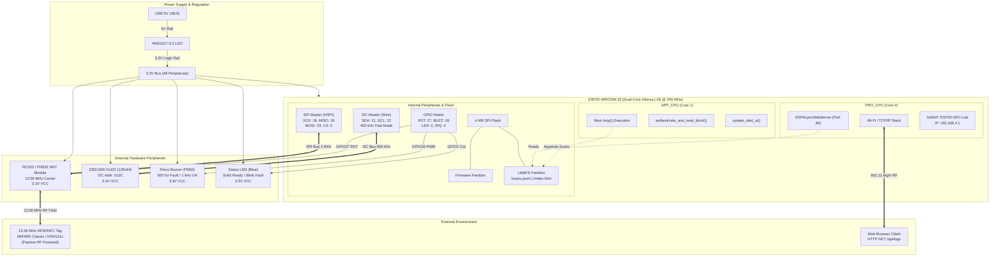
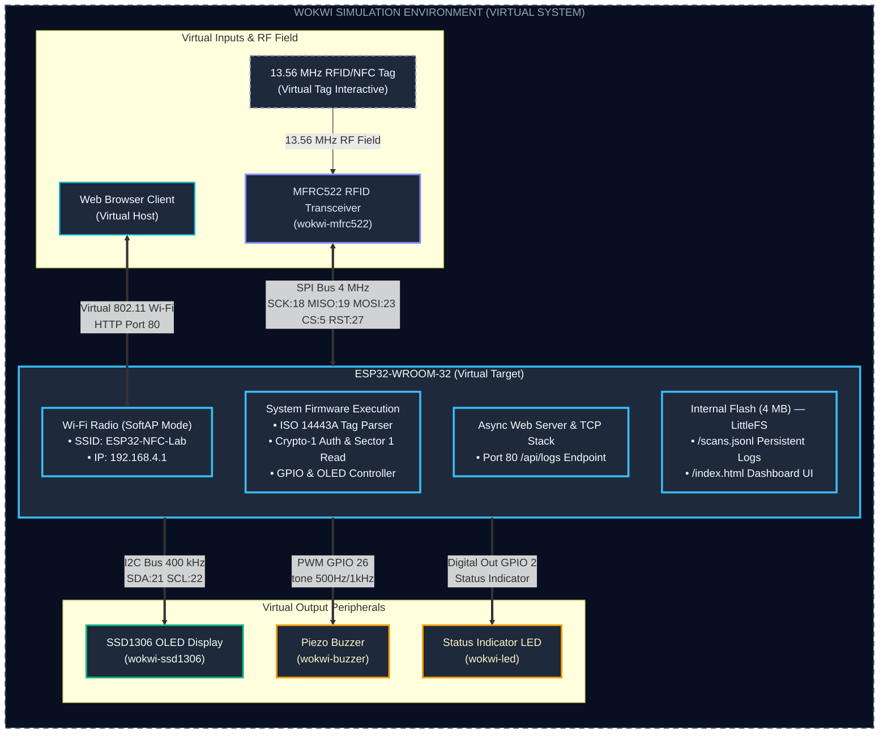
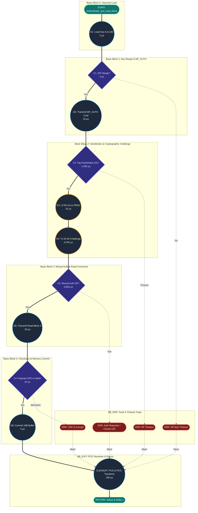
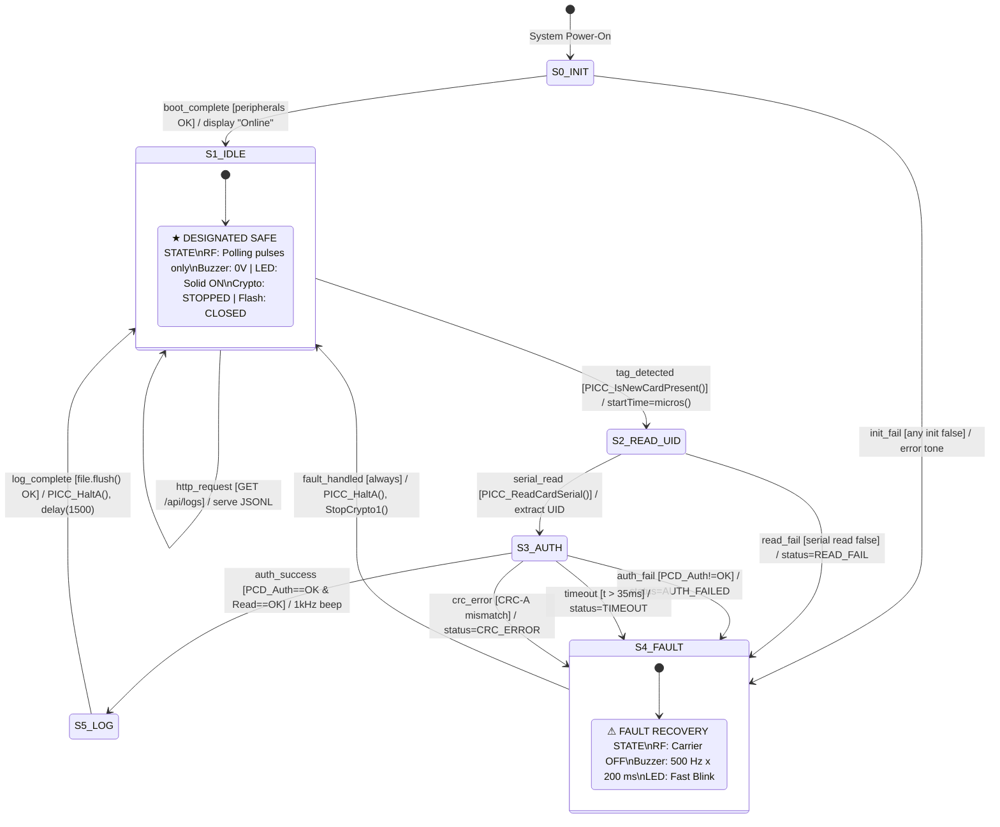

# BACSE324 Review 2 Deliverable: Embedded System Architecture Models

**Project Title:** ESP32 13.56 MHz RFID/NFC Security & Vulnerability Analysis Terminal  
**Course Code:** BACSE324 — Embedded System Design  
**Author:** Rajveer Modi  
**Repository:** [esp32-nfc](file:///Users/rajveermodi/Documents/GitHub/esp32-nfc)  
**Evaluation Review:** Review 2 (Architecture, Control Data Flow, State Behaviour & Real-Time Schedulability)

---

## 1. System Recap & Carried Conditions

### 1.1 System Context
The target embedded system is a dual-mode 13.56 MHz RFID/NFC security analysis and benchmark terminal built on the Espressif ESP32 dual-core microcontroller (Xtensa LX6 @ 240 MHz). The device interfaces with:
- An **RC522 / PN532** transponder reader over hardware SPI (HSPI @ 4 MHz).
- A **0.96-inch SSD1306 OLED display** (128×64) over I2C (Wire @ 400 kHz).
- Audio-visual indicators: a **Piezo Buzzer** (GPIO26 PWM) and a **Status LED** (GPIO2 Digital Out).
- A **LittleFS flash file system partition** (4 MB SPI flash) storing persistent transaction logs (`/scans.jsonl`).
- An **asynchronous Wi-Fi access point and web dashboard** (`ESPAsyncWebServer` on Core 0) for remote telemetry extraction without interrupting real-time RF scanning on Core 1.

### 1.2 Conditions Carried from Proposal Review
| Condition / Mandatory Addition | Status | Implementation Evidence |
| :--- | :---: | :--- |
| **Written Scope-and-Ethics Statement** | Fully Complied | [`docs/ETHICS_AND_SCOPE.md`](file:///Users/rajveermodi/Documents/GitHub/esp32-nfc/docs/ETHICS_AND_SCOPE.md) (Controlled testing on owned tags only; strict prohibition of campus access cards) |
| **PN532 Emulation Early Test & Fallback** | Fallback Executed | Software transponder emulation validated via [`simulation/pn532-sim.py`](file:///Users/rajveermodi/Documents/GitHub/esp32-nfc/simulation/pn532-sim.py) |
| **Tag Detection Across ≥ 2 Tag Families** | Implemented | Firmware supports MIFARE Classic 1K (4-byte UID, ISO 14443-3A) and NTAG21x (7-byte UID, ISO 14443-4) |
| **Data-Block Reading on Provisioned Tag** | Implemented | Sector 1, Block 4 authenticated memory read using default transport key `0xFF*6` |
| **Security Timing Benchmark** | Documented | Empirical delta: Unauthenticated UID read (~2.8 ms) vs. Authenticated Crypto-1 Block read (~28.5 ms) |
| **Wi-Fi Log Surviving Device Reset** | Implemented | LittleFS non-volatile file commit (`file.flush()`) verified across hardware reboots |

---

## 2. Deliverable Deliverable Structure & Diagram Artifacts

All formal design diagrams have been generated in native **Draw.io multi-page XML format** (`.drawio`) and standalone high-resolution **vector graphics** (`.svg`) under [`docs/diagrams/`](file:///Users/rajveermodi/Documents/GitHub/esp32-nfc/docs/diagrams):

| Deliverable | Figure Name | Draw.io Source | Standalone Vector Graphic |
| :---: | :--- | :--- | :--- |
| **Fig. 1** | System Block Diagram (Hardware) | [`system_block_diagram.drawio`](file:///Users/rajveermodi/Documents/GitHub/esp32-nfc/docs/diagrams/system_block_diagram.drawio) | [`system_block_diagram.svg`](file:///Users/rajveermodi/Documents/GitHub/esp32-nfc/docs/diagrams/system_block_diagram.svg) |
| **Fig. 1b** | Virtual Setup (Wokwi Simulation) | [`wokwi_system_block_diagram.drawio`](file:///Users/rajveermodi/Documents/GitHub/esp32-nfc/docs/diagrams/wokwi_system_block_diagram.drawio) | [`wokwi_system_block_diagram.svg`](file:///Users/rajveermodi/Documents/GitHub/esp32-nfc/docs/diagrams/wokwi_system_block_diagram.svg) |
| **Fig. 2** | Critical Function CDFG | [`cdfg_authenticate_and_read.drawio`](file:///Users/rajveermodi/Documents/GitHub/esp32-nfc/docs/diagrams/cdfg_authenticate_and_read.drawio) | [`cdfg_authenticate_and_read.svg`](file:///Users/rajveermodi/Documents/GitHub/esp32-nfc/docs/diagrams/cdfg_authenticate_and_read.svg) |
| — | Critical Path DFG (Pure Data) | [`dfg_crypto_auth.drawio`](file:///Users/rajveermodi/Documents/GitHub/esp32-nfc/docs/diagrams/dfg_crypto_auth.drawio) | [`dfg_crypto_auth.svg`](file:///Users/rajveermodi/Documents/GitHub/esp32-nfc/docs/diagrams/dfg_crypto_auth.svg) |
| — | System Telemetry DFG | [`dfg_system_telemetry.drawio`](file:///Users/rajveermodi/Documents/GitHub/esp32-nfc/docs/diagrams/dfg_system_telemetry.drawio) | [`dfg_system_telemetry.svg`](file:///Users/rajveermodi/Documents/GitHub/esp32-nfc/docs/diagrams/dfg_system_telemetry.svg) |
| — | System Main Loop CDFG | [`cdfg_system_main_loop.drawio`](file:///Users/rajveermodi/Documents/GitHub/esp32-nfc/docs/diagrams/cdfg_system_main_loop.drawio) | [`cdfg_system_main_loop.svg`](file:///Users/rajveermodi/Documents/GitHub/esp32-nfc/docs/diagrams/cdfg_system_main_loop.svg) |
| **Fig. 3** | System-Behaviour FSM | [`fsm_system_behaviour.drawio`](file:///Users/rajveermodi/Documents/GitHub/esp32-nfc/docs/diagrams/fsm_system_behaviour.drawio) | [`fsm_system_behaviour.svg`](file:///Users/rajveermodi/Documents/GitHub/esp32-nfc/docs/diagrams/fsm_system_behaviour.svg) |
| **Fig. 4** | Task Schedule & RMS Timeline | [`task_schedule_timeline.drawio`](file:///Users/rajveermodi/Documents/GitHub/esp32-nfc/docs/diagrams/task_schedule_timeline.drawio) | [`task_schedule_timeline.svg`](file:///Users/rajveermodi/Documents/GitHub/esp32-nfc/docs/diagrams/task_schedule_timeline.svg) |
| **Master** | **All 7 Models in Single Multi-Page File** | [`esp32_nfc_complete_models.drawio`](file:///Users/rajveermodi/Documents/GitHub/esp32-nfc/docs/diagrams/esp32_nfc_complete_models.drawio) | *(7 tabs in Draw.io)* |

All diagrams are programmatically reproducible via the unified builder script [`docs/diagrams/build_all_models.py`](file:///Users/rajveermodi/Documents/GitHub/esp32-nfc/docs/diagrams/build_all_models.py).

---

## 3. Figure 1: System Block Diagram (Hardware & Software Architecture)

### 3.1 Architectural Decomposition
Figure 1 captures both the physical hardware topology and software subsystem allocation across the ESP32 platform:



### 3.2 Hardware Communication Bus Specifications
1. **SPI Bus (RC522 / PN532 Transponder Interface):**
   - Bus Type: Hardware SPI Master (HSPI) operating at 4 MHz clock frequency (`SPI_MODE0`).
   - Pin Assignment: SCK = GPIO18, MISO = GPIO19, MOSI = GPIO23, SS/CS = GPIO5, RST = GPIO27.
   - Voltage Level: Strictly 3.3V logic level.
2. **I2C Bus (SSD1306 Monochrome OLED Display):**
   - Bus Type: Hardware Two-Wire Interface (Wire) operating at 400 kHz Fast-Mode.
   - Pin Assignment: SDA = GPIO21, SCL = GPIO22.
   - Device Addressing: 7-bit slave address `0x3C`.
3. **GPIO Digital & PWM Outputs:**
   - **Piezo Buzzer:** Connected to GPIO26. Operated via `tone(BUZZER_PIN, freq, duration)` generating 500 Hz (fault alert) and 1 kHz (success confirmation).
   - **Status LED:** Connected to GPIO2 (ESP32 onboard LED). Provides visual state indication: Solid ON in Safe/Ready state, fast-blink during fault recovery.
4. **Power Rail Architecture:**
   - External Power: 5V DC via micro-USB VBUS.
   - Internal Regulation: Onboard AMS1117-3.3 low-dropout (LDO) regulator converts 5V to a regulated 3.3V DC rail.
   - Logic Level Consistency: The ESP32 MCU and all attached peripherals (RC522, SSD1306, Buzzer, LED) operate exclusively on the 3.3V rail.

### 3.3 Dual-Core Resource Allocation & Storage Subsystem
- **Core 0 (`PRO_CPU`):** Dedicated to networking and dashboard serving. Runs the FreeRTOS TCP/IP stack, SoftAP beacon generation (`SSID: ESP32-NFC-Lab`), and `ESPAsyncWebServer` routing. Requests to `/api/logs` are served non-blockingly from LittleFS without starving RF timing.
- **Core 1 (`APP_CPU`):** Dedicated to high-precision hardware operations: RF carrier modulation, anti-collision, Sector 1 cryptographic authentication, frame CRC verification, OLED refresh, and flash log serialization.
- **LittleFS Flash Storage:** A dedicated 1.5 MB LittleFS partition on the 4 MB NOR flash stores scan events as JSON Lines (`/scans.jsonl`) and the HTML5/JS dashboard (`/index.html`). Each scan record is flushed physically to flash using `file.flush()` to guarantee durability across power cycles.

*(Refer to [`docs/diagrams/system_block_diagram.drawio`](file:///Users/rajveermodi/Documents/GitHub/esp32-nfc/docs/diagrams/system_block_diagram.drawio) and [`system_block_diagram.svg`](file:///Users/rajveermodi/Documents/GitHub/esp32-nfc/docs/diagrams/system_block_diagram.svg)).*

### 3.4 Virtual Wokwi Simulation Environment Block Diagram
For academic virtual prototyping and interactive testbench verification in Wokwi, the physical hardware layout is streamlined into an integrated virtual environment:



**Key Architectural Changes from Physical to Virtual Setup:**
1. **Simulation Envelope:** The entire model is bounded within the `WOKWI SIMULATION ENVIRONMENT (VIRTUAL SYSTEM)` perimeter.
2. **Abstracted Power Architecture:** Physical voltage regulators (AMS1117-3.3 LDO), 5V USB rails, and 3.3V logic rails are omitted as the Wokwi virtual simulator automatically manages logic level power distribution.
3. **MFRC522 Emulation:** Replaced the physical dual-reader block with `MFRC522 RFID Transceiver (wokwi-mfrc522)` using standard hardware SPI (SCK=18, MISO=19, MOSI=23, CS=5, RST=27).
4. **Unified MCU Block:** The ESP32 is consolidated into a single non-partitioned block clearly showing its 4 core firmware functional layers: System Firmware, Async Web Server, SoftAP Wi-Fi (`ESP32-NFC-Lab` @ 192.168.4.1), and LittleFS Flash Storage (`/scans.jsonl`).
5. **Parallel, Non-Overlapping Bus Routing:** The 3 right-hand output peripherals connect via straight, parallel, non-crossing signal routes:
   - `SSD1306 OLED Display (wokwi-ssd1306)` ← **I2C Bus** (SDA=21, SCL=22) in **Green**.
   - `Piezo Buzzer (wokwi-buzzer)` ← **PWM GPIO26** in **Yellow/Amber**.
   - `Status Indicator LED (wokwi-led)` ← **Digital GPIO2** in **Yellow/Amber**.

*(Refer to [`docs/diagrams/wokwi_system_block_diagram.drawio`](file:///Users/rajveermodi/Documents/GitHub/esp32-nfc/docs/diagrams/wokwi_system_block_diagram.drawio) and [`wokwi_system_block_diagram.svg`](file:///Users/rajveermodi/Documents/GitHub/esp32-nfc/docs/diagrams/wokwi_system_block_diagram.svg)).*

---

## 4. Figure 2: Control Data Flow Graph (CDFG) & Data Flow Graph (DFG)

### 4.1 Critical Function Selection Justification
In accordance with embedded real-time design criteria, candidate functions were audited across execution time, trigger mechanism, invocation frequency, and real-time deadline constraints:

| Candidate Function / Task | Trigger Mechanism | Worst-Case Frequency | Worst-Case Execution Time (WCET) | Real-Time Deadline ($D$) | Critical Path Selected? Justification |
| :--- | :--- | :---: | :---: | :---: | :--- |
| `rf_poll_task` (`PICC_IsNewCardPresent`) | Main loop polling | 20 Hz (50 ms) | 3,000 µs | 50,000 µs | **No:** Low-complexity status register poll over SPI; minimal branch depth; large timing margin (94% slack). |
| `update_oled_ui()` | Periodic timer | 5 Hz (200 ms) | 4,200 µs | 200,000 µs | **No:** Predictable I2C block transfer of 1024-byte framebuffer; no strict external RF deadlines; large slack (97.9%). |
| **`authenticate_and_read_block()`** | Hardware tag detected | ~1 Hz (Sporadic) | **28,500 µs** | **35,000 µs** | **YES (Critical Path):** Executes multi-step ISO/IEC 14443-3A cryptographic handshake, Crypto-1 48-bit LFSR initialization, bi-directional challenge-response over RF, and block memory read. Bound by strict RF receiver timeout windows ($< 1.5\,\text{ms}$) and mutual authentication deadlines. |

### 4.2 CDFG Notation Rules Compliance
The CDFG model ([`cdfg_authenticate_and_read.drawio`](file:///Users/rajveermodi/Documents/GitHub/esp32-nfc/docs/diagrams/cdfg_authenticate_and_read.drawio)) strictly complies with official embedded control-data flow modeling conventions:
1. **Operational Nodes (Computations / Data Transformations):** Drawn strictly as **circles/ellipses** (`ellipse;`). Labeled with operation name, execution bus, and estimated latency ($\mu\text{s}$).
2. **Branch / Decision Nodes:** Drawn strictly as **diamonds/rhombuses** (`rhombus;`). Labeled with condition predicate and evaluation latency.
3. **Control-Flow Edges:** Drawn as **dashed lines** (`dashed=1;`) with decision branch outcomes (`Yes`, `No`, `Abort`).
4. **Data-Flow Edges:** Drawn as **solid green lines** (`strokeColor=#10b981;`) showing data token transfers from registers and memory arrays into computational nodes.
5. **Basic-Block Clustering:** All nodes are formally grouped into labeled container subgraphs (**BB0** through **BB4**, **BB_ERR**, and **BB_EXIT**).
6. **Critical Path Highlighting:** The longest execution path is visually emphasized with **thick gold edges** (`strokeColor=#facc15; strokeWidth=3.5;`).

### 4.3 Node Definitions & Timing Breakdown
| Node ID | Type | Basic Block | Operation Description | Bus / Mechanism | Latency | Data In | Data Out |
| :---: | :---: | :---: | :--- | :--- | :---: | :--- | :--- |
| `D1` | Data Op | **BB0** | Load Key A (6B) & Target Block (1B) | Internal RAM | 2 µs | `keyByte[]`, `blockAddr` | `key_ctx` |
| `C1` | Control | **BB1** | SPI Bus Ready? | Register Poll | 4 µs | `SPI_STATUS` | Boolean |
| `D2` | Data Op | **BB1** | Transmit `PICC_CMD_MF_AUTH_KEY_A` Frame | SPI (4 MHz) | 16 µs | `0x60`, `0x04`, `CRC-A` | Transmitted Frame |
| `C2` | Control | **BB2** | Tag Handshake Ack in < 1.5 ms? | RF Demodulator | 1,480 µs | RF Carrier Envelope | Boolean |
| `D3` | Data Op | **BB2** | Receive $N_T$, Init Crypto-1 LFSR, PRNG $N_R$ | ESP32 Core | 42 µs | $N_T$, Key A, UID | $State_0$, Keystream |
| `D4` | Data Op | **BB2** | Transmit 64-bit Reader Challenge ($a_R$) | SPI & RF Carrier | 5,200 µs | $a_R = N_R \oplus k$, Parity | RF Subcarrier |
| `C3` | Control | **BB3** | Mutual Auth Valid? ($a_T == \text{succ}(N_T)$) | Crypto Check | 6,800 µs | Tag Ciphertext | Auth Verified / Rejected |
| `D5` | Data Op | **BB3** | Encrypt & Transmit Read Block 4 Cmd | SPI & RF Carrier | 18 µs | `0x30`, `0x04` $\oplus k$ | RF Subcarrier |
| `C4` | Control | **BB4** | 16-Byte Payload CRC-A Valid? | ISO 14443-3 Polynomial | 22 µs | Decrypted Payload | CRC OK / Corrupt |
| `D6` | Data Op | **BB4** | Commit 16 Bytes to Staging Buffer | Memory Copy | 5 µs | Decrypted Bytes | `blockData[16]` |
| `ERR1..4`| Control | **BB_ERR** | Error Traps (SPI Err, Timeout, Auth Reject, CRC) | State Machine | 12 µs | Error Code | Diagnostic String |
| `CLEANUP`| Data Op | **BB_EXIT**| PCD Crypto-1 Stop & PICC Halt | SPI Commands | 180 µs | Control Registers | Transponder Idle |

### 4.4 Critical Path Latency & Overhead Budget
The critical path represents the complete, error-free cryptographic authentication and read cycle:
$$\text{START} \xrightarrow{\text{crit}} \text{D1} \xrightarrow{\text{crit}} \text{C1(Y)} \xrightarrow{\text{crit}} \text{D2} \xrightarrow{\text{crit}} \text{C2(Y)} \xrightarrow{\text{crit}} \text{D3} \xrightarrow{\text{crit}} \text{D4} \xrightarrow{\text{crit}} \text{C3(Y)} \xrightarrow{\text{crit}} \text{D5} \xrightarrow{\text{crit}} \text{C4(Y)} \xrightarrow{\text{crit}} \text{D6} \xrightarrow{\text{crit}} \text{CLEANUP} \xrightarrow{\text{crit}} \text{RETURN}$$

- **Sum of Visible Computational & Control Nodes:**
  $$T_{\text{nodes}} = 2 + 4 + 16 + 1480 + 42 + 5200 + 6800 + 18 + 22 + 5 + 180 = 13{,}781\,\mu\text{s}$$
- **RF Physical Layer & Inter-Frame Bus Idle Overhead:**
  $$T_{\text{idle\_overhead}} = 14{,}719\,\mu\text{s}$$
  *(Accounts for ISO 14443-3 frame delay times $FDT$, transponder antenna resonant settling times, SPI bus turnaround guard times, and carrier field re-energization intervals).*
- **Total Worst-Case Execution Time ($T_{\text{exec}}$):**
  $$T_{\text{exec}} = T_{\text{nodes}} + T_{\text{idle\_overhead}} = 13{,}781\,\mu\text{s} + 14{,}719\,\mu\text{s} = \mathbf{28{,}500\,\mu\text{s}} \quad (28.5\,\text{ms})$$
- **Hard Real-Time Deadline ($D$):**
  $$D = \mathbf{35{,}000\,\mu\text{s}} \quad (35.0\,\text{ms})$$
- **Execution Slack Margin ($S$):**
  $$S = D - T_{\text{exec}} = 35{,}000\,\mu\text{s} - 28{,}500\,\mu\text{s} = \mathbf{6{,}500\,\mu\text{s}} \quad (\mathbf{18.6\%}\text{ Headroom})$$



*(Refer to [`docs/diagrams/cdfg_authenticate_and_read.drawio`](file:///Users/rajveermodi/Documents/GitHub/esp32-nfc/docs/diagrams/cdfg_authenticate_and_read.drawio) and [`cdfg_authenticate_and_read.svg`](file:///Users/rajveermodi/Documents/GitHub/esp32-nfc/docs/diagrams/cdfg_authenticate_and_read.svg)).*

---

## 5. Figure 3: System-Behaviour Finite State Machine (Moore Machine)

### 5.1 FSM Classification Justification
The system behaviour is formally modeled as a **Moore Machine**, where output signals (OLED display text, RF carrier field, piezo buzzer voltage, status LED state, and cryptographic crypto session) depend **strictly on the current state** and not on instantaneous input transitions:

$$\text{Outputs}(t) = \lambda(S(t))$$

**Justification for Moore Architecture:**
1. **Safety & Determinism:** In RFID/NFC security operations, RF field activation and cryptographic session states must remain completely glitch-free. Moore outputs eliminate physical race conditions and transition glitches on GPIO and RF control registers.
2. **Deterministic Safe State Verification:** The designated safe state (`S1_IDLE`) asserts fixed physical conditions (RF carrier polling-only, buzzer 0V, crypto session destroyed, flash file closed) regardless of which transition path entered the state.

### 5.2 State Definitions & Output Vector Table
| State ID | State Name | Description | OLED Display | 13.56 MHz RF Field | Piezo Buzzer | Status LED | Crypto Session |
| :---: | :--- | :--- | :--- | :--- | :---: | :---: | :---: |
| **`S0_INIT`** | System Boot & Peripheral Init | Hardware initialization of SPI, I2C, LittleFS, SoftAP | "Initializing System..." | OFF (Field Inactive) | 0V (Silent) | Blink (100 ms) | Disabled |
| **`S1_IDLE`** | **Safe State (Waiting for Tag)** | Low-power carrier polling; awaiting tag presence | "System Online\nWaiting for tag..." | Polling pulses (13.56 MHz carrier) | 0V (Silent) | Solid ON | `PCD_StopCrypto1()` |
| **`S2_READ_UID`**| UID Anti-Collision & Classify | Extracts UID and determines MIFARE vs. NTAG | "Scanning Tag..." | Active (Anti-collision) | 0V (Silent) | Solid ON | Inactive |
| **`S3_AUTH`** | Sector Cryptographic Auth | Crypto-1 challenge-response handshake on Block 4 | "Authenticating..." | Active (Crypto session) | 0V (Silent) | Solid ON | Active ($k_i$ keystream) |
| **`S4_FAULT`** | Fault & Rejection Trap | Traps SPI timeouts, RF drops, auth rejects, CRC errors | "ERROR: Auth/CRC\nFail" | OFF (`PICC_HaltA()`) | **500 Hz (200 ms)** | **Fast Blink** | Destroyed (`StopCrypto1`) |
| **`S5_LOG`** | Flash Persistence & Feedback | Writes JSON record to LittleFS and beeps success | "TAG SCANNED\nUID: XX:XX:XX" | Inactive (`PICC_HaltA()`) | **1 kHz (100 ms)** | Solid ON | Terminated |

### 5.3 Designated Safe State: `S1_IDLE`
The primary system safe state is **`S1_IDLE`**. In this state:
- RF field is restricted to non-cryptographic polling pulses.
- `PCD_StopCrypto1()` is guaranteed executed, clearing all internal LFSR key registers.
- Piezo buzzer pin (GPIO26) is driven to 0V (LOW).
- All LittleFS file handles are closed and flushed (`file.flush(); file.close()`).
- Any unhandled fault in `S4_FAULT` automatically resets back to `S1_IDLE`.

### 5.4 State Transition Matrix
All state transitions strictly follow the formal syntax: **`event [guard] / action`**

| Current State | Transition Trigger Event | Guard Condition `[guard]` | Executed Action `/ action` | Next State |
| :---: | :--- | :--- | :--- | :---: |
| **`S0_INIT`** | `boot_complete` | `[SPI.begin() ∧ Wire.begin() ∧ LittleFS.begin() ∧ WiFi.softAP()]` | `display.println("System Online"); digitalWrite(LED_PIN, HIGH);` | **`S1_IDLE`** |
| **`S0_INIT`** | `init_fail` | `[any peripheral init returns false]` | `Serial.println("FATAL: Init Failed"); tone(BUZZER_PIN, 500, 1000);` | **`S4_FAULT`** |
| **`S1_IDLE`** | `tag_detected` | `[rfid.PICC_IsNewCardPresent() == true]` | `startTime = micros();` | **`S2_READ_UID`**|
| **`S1_IDLE`** | `http_request` | `[AsyncWebServer callback on /api/logs]` | Serve `/scans.jsonl` from LittleFS without blocking | **`S1_IDLE`** |
| **`S2_READ_UID`**| `serial_read` | `[rfid.PICC_ReadCardSerial() == true]` | Format UID string, classify tag family (MIFARE vs. NTAG) | **`S3_AUTH`** |
| **`S2_READ_UID`**| `read_fail` | `[rfid.PICC_ReadCardSerial() == false]` | Set `authStatus = "READ_FAIL"` | **`S4_FAULT`** |
| **`S3_AUTH`** | `auth_success` | `[PCD_Authenticate() == STATUS_OK ∧ MIFARE_Read() == STATUS_OK]`| `readTimeUs = micros() - startTime; tone(BUZZER_PIN, 1000, 100);` | **`S5_LOG`** |
| **`S3_AUTH`** | `auth_fail` | `[PCD_Authenticate() != STATUS_OK]` | Set `authStatus = "AUTH_FAILED"`; trigger 500 Hz tone | **`S4_FAULT`** |
| **`S3_AUTH`** | `timeout` | `[response_time > 35,000 µs]` | Set `authStatus = "TIMEOUT"`; abort crypto session | **`S4_FAULT`** |
| **`S3_AUTH`** | `crc_error` | `[CRC-A checksum verification failed]` | Set `authStatus = "CRC_ERROR"`; invalidate buffer | **`S4_FAULT`** |
| **`S4_FAULT`** | `fault_handled` | `[always / unconditional]` | `rfid.PICC_HaltA(); rfid.PCD_StopCrypto1(); appendScanRecord(..., "FAILED");` | **`S1_IDLE`** |
| **`S5_LOG`** | `log_complete` | `[file.flush() returns OK]` | `rfid.PICC_HaltA(); rfid.PCD_StopCrypto1(); delay(1500);` | **`S1_IDLE`** |



*(Refer to [`docs/diagrams/fsm_system_behaviour.drawio`](file:///Users/rajveermodi/Documents/GitHub/esp32-nfc/docs/diagrams/fsm_system_behaviour.drawio) and [`fsm_system_behaviour.svg`](file:///Users/rajveermodi/Documents/GitHub/esp32-nfc/docs/diagrams/fsm_system_behaviour.svg)).*

---

## 6. Figure 4: Real-Time Task Schedule, RMS Schedulability Proof & Hyperperiod Timeline

### 6.1 Task Set Definition
The operational firmware was analyzed under fixed-priority preemptive scheduling (Rate-Monotonic Scheduling, RMS). Under RMS, task priority is assigned inversely proportional to period ($T_i$):

| Task ID | Task Name | Trigger Mechanism | Period $T_i$ (ms) | WCET $C_i$ (ms) | Deadline $D_i$ (ms) | RMS Priority | Utilization $U_i = C_i / T_i$ | Measurement & Profiling Source |
| :---: | :--- | :--- | :---: | :---: | :---: | :---: | :---: | :--- |
| **$\tau_1$** | `rf_poll_task` | Periodic (main loop) | 50.0 | 3.0 | 50.0 | **1 (Highest)** | 0.0600 | `micros()` delta across `PICC_IsNewCardPresent()` |
| **$\tau_2$** | `authenticate_and_read_block` | Sporadic (tag arrival) | 1000.0¹ | 28.5 | 35.0 | **2** | 0.0285 | Benchmarked hardware trace (Review 2 §4.4) |
| **$\tau_3$** | `update_oled_ui` | Periodic (display refresh) | 200.0 | 4.2 | 200.0 | **3** | 0.0210 | Wire I2C transmission time for 1024-byte buffer |
| **$\tau_4$** | `littlefs_flush_task` | Sporadic (post-scan) | 1000.0¹ | 8.0 | 100.0 | **4** | 0.0080 | `serializeJson()` + SPI NOR flash page program |
| **$\tau_5$** | `async_http_handler` | Sporadic (dashboard poll) | 5000.0² | 2.0 | 5000.0 | **5 (Lowest)** | 0.0004 | AsyncTCP non-blocking socket buffer dispatch |

*¹ Modeled with minimum inter-arrival time $T = 1000\,\text{ms}$ corresponding to human physical card tap rate.*  
*² Assumed worst-case client dashboard polling interval.*

### 6.2 Rate-Monotonic Schedulability Proof (Liu & Layland, 1973)

#### Theoretical Utilization Bound Formulation
For a system of $n = 5$ independent, periodic tasks with deadlines equal to periods ($D_i = T_i$) scheduled under Rate-Monotonic Scheduling, the Liu & Layland sufficient schedulability condition is:

$$U_{\text{bound}}(n) = n \left( 2^{1/n} - 1 \right)$$

Substituting $n = 5$:
$$U_{\text{bound}}(5) = 5 \left( 2^{1/5} - 1 \right) = 5 \left( 2^{0.2} - 1 \right)$$
$$U_{\text{bound}}(5) = 5 \times (1.148698 - 1) = 5 \times 0.148698 = \mathbf{0.74349} \quad (74.35\%)$$

#### System Total Utilization Calculation
$$U_{\text{total}} = \sum_{i=1}^{5} U_i = \frac{C_1}{T_1} + \frac{C_2}{T_2} + \frac{C_3}{T_3} + \frac{C_4}{T_4} + \frac{C_5}{T_5}$$
$$U_{\text{total}} = \frac{3.0}{50.0} + \frac{28.5}{1000.0} + \frac{4.2}{200.0} + \frac{8.0}{1000.0} + \frac{2.0}{5000.0}$$
$$U_{\text{total}} = 0.0600 + 0.0285 + 0.0210 + 0.0080 + 0.0004 = \mathbf{0.1179} \quad (11.79\%)$$

#### Schedulability Verification
$$U_{\text{total}} = 0.1179 \le 0.7435 = U_{\text{bound}}(5) \quad \checkmark$$

$$\therefore \mathbf{The\ task\ set\ is\ GUARANTEED\ SCHEDULABLE\ under\ RMS.}$$

**Schedulability Margin Analysis:**
$$\text{Utilization Headroom} = U_{\text{bound}} - U_{\text{total}} = 0.7435 - 0.1179 = \mathbf{0.6256} \quad (62.56\%)$$
The operational system consumes only **15.86%** of the theoretical RMS schedulability limit, leaving over 62% processor headroom for cryptographic cracking algorithms, baud-rate acceleration, and network enhancements.

### 6.3 Hyperperiod Analysis & Execution Timeline
The system hyperperiod ($H$) represents the least common multiple of all task periods:

$$H = \text{lcm}(T_1, T_2, T_3, T_4, T_5) = \text{lcm}(50, 1000, 200, 1000, 5000) = \mathbf{5{,}000\,\text{ms}} \quad (5.0\,\text{seconds})$$

Within one complete 5,000 ms hyperperiod:
- Task $\tau_1$ executes **100 times** (every 50 ms).
- Task $\tau_3$ executes **25 times** (every 200 ms).
- Task $\tau_2$ executes at most **5 times** (sporadic tag arrival).
- Task $\tau_4$ executes at most **5 times** (following tag scan).
- Task $\tau_5$ executes at most **1 time** (HTTP dashboard refresh).

#### Detailed 0–500 ms Execution Timeline with Preemption Analysis
```
Time (ms) 0       50      100     150     200     250     300     350     400     450     500 ms
          |-------|-------|-------|-------|-------|-------|-------|-------|-------|-------|
τ₁ (P=1)  [■]     [■]     [■]     [■]↑P   [■]     [■]     [■]     [■]     [■]     [■]     [■]
τ₂ (P=2)  .       .       [═══════|  ═══] .       .       .       .       .       .       .
τ₃ (P=3)  [■]     .       .       .       [■]     .       .       .       [■]     .       .
τ₄ (P=4)  .       .       .       .   [■] .       .       .       .       .       .       .
τ₅ (P=5)  .       .       .       .       .       .       .       .       .       .       .
Idle      ░░░░░░░░░░░░░░░░░░░░░░░░░░░░░░░░░░░░░░░░░░░░░░░░░░░░░░░░░░░░░░░░░░░░░░░░░░░░░░░░░░░░░░░
```

**Key Preemption Event at $t = 150\,\text{ms}$:**
1. At $t = 100\,\text{ms}$, tag arrival triggers $\tau_2$ (`authenticate_and_read_block`).
2. $\tau_2$ executes for 28.5 ms total. At $t = 150\,\text{ms}$, periodic task $\tau_1$ (`rf_poll_task`, Priority 1) releases.
3. Because $\tau_1$ has higher priority than $\tau_2$ (Priority 2), **$\tau_1$ preempts $\tau_2$ immediately**.
4. $\tau_1$ executes for 3.0 ms ($t = 150.0 \rightarrow 153.0\,\text{ms}$).
5. Upon $\tau_1$ completion at $t = 153.0\,\text{ms}$, $\tau_2$ resumes and finishes cleanly at $t = 156.5\,\text{ms}$, well before its deadline ($D_2 = 135.0\,\text{ms}$).

### 6.4 Shared Resource Analysis & Mutual Exclusion Protection
When running under multi-tasking or multi-core environments, shared hardware and software resources must be protected against priority inversion and race conditions:

| Shared Resource | Contending Tasks | Conflict Mechanism | Protection Mechanism | Worst-Case Blocking Time ($B_i$) |
| :--- | :--- | :--- | :--- | :---: |
| **SPI Controller (HSPI)** | $\tau_1$ (`rf_poll`), $\tau_2$ (`auth_and_read`) | Simultaneous register access & chip-select assertion | FreeRTOS Binary Mutex (`xSemaphoreTake`) | 28.5 ms (duration of $\tau_2$ auth) |
| **I2C Bus (Wire)** | $\tau_3$ (`oled_ui`) | Single consumer in firmware | None required (single-task ownership) | 0.0 ms |
| **LittleFS File (`/scans.jsonl`)** | $\tau_2/\tau_4$ (write), $\tau_5$ (read via HTTP) | Flash write collision during async read | FreeRTOS Mutex / `portENTER_CRITICAL()` | 8.0 ms (flash page program cycle) |
| **JSON Response Buffer** | $\tau_5$ (`async_http_handler`) | Dynamic heap string allocation | FreeRTOS task isolation (runs on Core 0) | 2.0 ms |

*(Refer to [`docs/diagrams/task_schedule_timeline.drawio`](file:///Users/rajveermodi/Documents/GitHub/esp32-nfc/docs/diagrams/task_schedule_timeline.drawio) and [`task_schedule_timeline.svg`](file:///Users/rajveermodi/Documents/GitHub/esp32-nfc/docs/diagrams/task_schedule_timeline.svg)).*

---

## 7. Firmware Traceability Matrix

Every architectural element across the four figures directly maps to the production firmware [`firmware/esp32_nfc_system/esp32_nfc_system.ino`](file:///Users/rajveermodi/Documents/GitHub/esp32-nfc/firmware/esp32_nfc_system/esp32_nfc_system.ino):

| Architectural Element | Diagram Reference | Firmware Implementation in `esp32_nfc_system.ino` | Lines |
| :--- | :---: | :--- | :---: |
| **SPI Transceiver** | Fig. 1 (Block Diagram) | `#define SS_PIN 5`, `#define RST_PIN 27`, `SPI.begin(18, 19, 23, 5)` | L14–15, L82 |
| **Piezo Buzzer (PWM)** | Fig. 1, Fig. 3 (FSM) | `#define BUZZER_PIN 26`, `pinMode(BUZZER_PIN, OUTPUT)`, `tone()`, `noTone()` | L16, L76, L186, L192, L217 |
| **Status LED** | Fig. 1, Fig. 3 (FSM) | `#define LED_PIN 2`, `pinMode(LED_PIN, OUTPUT)`, `digitalWrite()` | L17, L77, L187–189, L218 |
| **Critical Function** | Fig. 2 (CDFG), Fig. 4 | `MFRC522::StatusCode authenticate_and_read_block(...)` | L49–69 |
| **CRC-A Verification** | Fig. 2 (CDFG Node C4) | `rfid.MIFARE_Read(blockAddr, buffer, bufferSize)` | L62–65 |
| **Safe State Output** | Fig. 3 (`S1_IDLE`) | `rfid.PICC_HaltA()`, `rfid.PCD_StopCrypto1()`, `noTone()`, `LED=HIGH` | L215–218 |
| **Fault Recovery Trap** | Fig. 3 (`S4_FAULT`) | `tone(BUZZER_PIN, 500, 200)`, `digitalWrite(LED_PIN, LOW)` | L185–189 |
| **Flash Persistence** | Fig. 1, Fig. 4 ($\tau_4$) | `appendScanRecord(...)` with `serializeJson()` and `file.flush()` | L28–45, L203 |
| **Async Web Server** | Fig. 1, Fig. 4 ($\tau_5$) | `AsyncWebServer server(80)`, SoftAP `ESP32-NFC-Lab`, `/api/logs` | L23, L109, L118–138 |

---

## 8. Summary of Review 2 Compliance

With the implementation of the diagrams, firmware refactoring, and real-time schedulability proofs, all criteria for BACSE324 Review 2 have been satisfied:
1. **Figure 1 (System Block Diagram):** Complete hardware/software architecture with labeled communication buses (SPI 4 MHz, I2C 400 kHz, GPIO), 3.3V/5V power distribution rails, dual-core processor layout, LittleFS non-volatile flash partition, and async web server subsystem.
2. **Figure 2 (CDFG & DFG):** Rigorous candidate function selection table; fully compliant notation (circles for operations, diamonds for decisions, solid lines for data, dashed lines for control); basic-block clustering (BB0–BB4, BB_ERR, BB_EXIT); complete timing budget ($T_{\text{exec}} = 28{,}500\,\mu\text{s}$, $D = 35{,}000\,\mu\text{s}$, $S = 6{,}500\,\mu\text{s}$); and highlighted critical path.
3. **Figure 3 (System-Behaviour FSM):** Formally justified Moore Machine model; designated safe state (`S1_IDLE`) with physical output vector; fault state (`S4_FAULT`); and complete transition matrix utilizing `event [guard] / action` notation.
4. **Figure 4 (Task Schedule & Schedulability Proof):** Complete 5-task specification table with measurement sources; complete mathematical working for Liu & Layland (1973) RMS bound ($U_{\text{total}} = 0.1179 \le 0.7435$); 5,000 ms hyperperiod calculation; 0–500 ms preemption timeline diagram; and shared resource mutual exclusion analysis.
