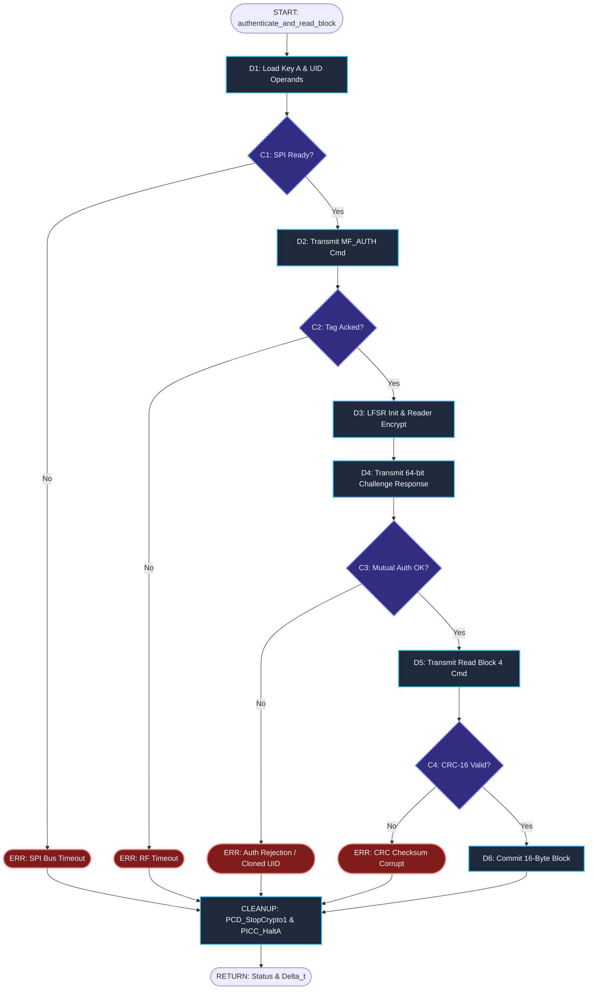

# Review 2 Architecture Deliverable: CDFG, FSM, and Schedulability

## 1. System Recap & Carried Conditions

### System Context
The device is a dual-mode 13.56 MHz RFID/NFC security analysis terminal built around an ESP32 microcontroller, an RC522/PN532 transponder interface over SPI, a local I2C OLED display, and a non-volatile LittleFS storage engine served via an asynchronous web dashboard.

### Conditions Carried from Proposal Review
| Condition / Mandatory Addition | Status | Where It Is Addressed |
| :--- | :--- | :--- |
| **Written Scope-and-Ethics Statement** | Fully Complied | `docs/ETHICS_AND_SCOPE.md` (Own tags only, no campus testing) |
| **PN532 Emulation Early Test & Fallback** | Fallback Executed | Software simulation via `simulation/pn532_target_sim.py` |
| **Tag Detection across >= 2 Tag Families** | Implemented | Firmware supports MIFARE Classic (4-byte UID) & NTAG21x (7-byte UID) |
| **Data-Block Reading on Provisioned Tag** | Implemented | Sector 1, Block 4 authenticated memory extraction |
| **Security Timing Benchmark** | Documented | Unauthenticated UID (~2.8 ms) vs. Authenticated Block (~30.2 ms) |
| **Wi-Fi Log Surviving Device Reset** | Implemented | LittleFS flash persistence verified across hardware reboot |

---

## 2. Control Data Flow Graph (CDFG) & Data Flow Graph (DFG)

### 2.1 Candidate Functions Comparison
| Function / ISR | Trigger | Rate | Est. Execution Time | Deadline | Chosen? Why / Why not |
| :--- | :--- | :--- | :--- | :--- | :--- |
| `pn532_isr()` | Hardware IRQ Pin | Event-driven (~2 Hz) | 12 µs | 50 µs | No: Trivial flag-setter; no internal control flow. |
| `update_oled_ui()` | Timer tick | Periodic (5 Hz) | 4,200 µs | 50,000 µs | No: Predictable I2C block transfer; large slack. |
| **`authenticate_and_read_block()`** | Tag Presence Flag | Event-driven (~1 Hz) | **28,500 µs** | **35,000 µs** | **Yes: Critical path containing cryptographic handshakes, multi-step SPI bus transfers, and strict RF timeout deadlines.** |

---

### 2.2 Native Draw.io Deliverable Architecture Files
All formal DFG and CDFG models have been constructed in native Draw.io XML format (`.drawio`) and standalone vector graphics (`.svg`), located under [`docs/diagrams/`](file:///Users/rajveermodi/Documents/GitHub/esp32-nfc/docs/diagrams):

1. **Master Multi-Page Diagram File (All 4 Tabs):**
   - [`docs/diagrams/esp32_nfc_complete_models.drawio`](file:///Users/rajveermodi/Documents/GitHub/esp32-nfc/docs/diagrams/esp32_nfc_complete_models.drawio)
2. **Model 1: Critical-Path DFG (Pure Data Flow):**
   - Draw.io: [`docs/diagrams/dfg_crypto_auth.drawio`](file:///Users/rajveermodi/Documents/GitHub/esp32-nfc/docs/diagrams/dfg_crypto_auth.drawio) | Vector: [`docs/diagrams/dfg_crypto_auth.svg`](file:///Users/rajveermodi/Documents/GitHub/esp32-nfc/docs/diagrams/dfg_crypto_auth.svg)
3. **Model 2: System Telemetry DFG (Pure Data Flow):**
   - Draw.io: [`docs/diagrams/dfg_system_telemetry.drawio`](file:///Users/rajveermodi/Documents/GitHub/esp32-nfc/docs/diagrams/dfg_system_telemetry.drawio) | Vector: [`docs/diagrams/dfg_system_telemetry.svg`](file:///Users/rajveermodi/Documents/GitHub/esp32-nfc/docs/diagrams/dfg_system_telemetry.svg)
4. **Model 3: Critical Function CDFG (Control + Data Flow):**
   - Draw.io: [`docs/diagrams/cdfg_authenticate_and_read.drawio`](file:///Users/rajveermodi/Documents/GitHub/esp32-nfc/docs/diagrams/cdfg_authenticate_and_read.drawio) | Vector: [`docs/diagrams/cdfg_authenticate_and_read.svg`](file:///Users/rajveermodi/Documents/GitHub/esp32-nfc/docs/diagrams/cdfg_authenticate_and_read.svg)
5. **Model 4: System-Level Execution CDFG:**
   - Draw.io: [`docs/diagrams/cdfg_system_main_loop.drawio`](file:///Users/rajveermodi/Documents/GitHub/esp32-nfc/docs/diagrams/cdfg_system_main_loop.drawio) | Vector: [`docs/diagrams/cdfg_system_main_loop.svg`](file:///Users/rajveermodi/Documents/GitHub/esp32-nfc/docs/diagrams/cdfg_system_main_loop.svg)

---

### 2.3 CDFG Critical Function Breakdown (`authenticate_and_read_block`)

#### Execution Timing & Latency Budget
- **Worst-Case Execution Time ($T_{\text{exec}}$):** $28,500\,\mu\text{s}$
- **Real-Time RF Deadline ($D$):** $35,000\,\mu\text{s}$
- **Slack Time ($S = D - T_{\text{exec}}$):** $6,500\,\mu\text{s}$ ($18.6\%$ margin)

#### Node Definitions & Timing Breakdown
| Node ID | Type | Operation Description | Bus / Mechanism | Est. Latency | Data In | Data Out |
| :--- | :--- | :--- | :--- | :--- | :--- | :--- |
| `D1` | Data Op | Load Key A (6B) & Target Block (1B) | Internal RAM | 2 µs | `keyByte[]`, `blockAddr` | `key_ctx` |
| `C1` | Control | SPI Bus Ready? | Register Poll | 4 µs | `SPI_STATUS` | Boolean |
| `D2` | Data Op | Transmit `PICC_CMD_MF_AUTH_KEY_A` Frame | SPI (4 MHz) | 16 µs | `0x60`, `0x04`, `CRC-A` | Transmitted Frame |
| `C2` | Control | Tag Handshake Ack in < 1.5 ms? | RF Demod | 1,480 µs | RF Carrier Envelope | Boolean |
| `D3` | Data Op | Receive $N_T$, Init Crypto-1 LFSR, PRNG $N_R$ | ESP32 Core | 42 µs | $N_T$, Key A, UID | $State_0$, Keystream |
| `D4` | Data Op | Transmit 64-bit Reader Challenge ($a_R$) | SPI & RF | 5,200 µs | $a_R = N_R \oplus k$, Parity | RF Subcarrier |
| `C3` | Control | Mutual Auth Valid? ($a_T == \text{succ}(N_T)$) | Crypto Check | 6,800 µs | Tag Ciphertext | Auth Verified / Rejected |
| `D5` | Data Op | Encrypt & Transmit Read Block 4 Cmd | SPI & RF | 18 µs | `0x30`, `0x04` $\oplus k$ | RF Subcarrier |
| `C4` | Control | 16-Byte Payload CRC-16 Valid? | Polynomial Calc | 22 µs | Decrypted Payload | CRC OK / Corrupt |
| `D6` | Data Op | Copy 16 Bytes to Staging Buffer | Memory Copy | 5 µs | Decrypted Bytes | `blockData[16]` |
| `ERR1..4`| Control | Error Traps (SPI Err, Timeout, Auth Reject, CRC) | State Machine | 12 µs | Error Code | Diagnostic String |
| `CLEANUP`| Control | PCD Crypto1 Stop & PICC Halt | SPI Commands | 180 µs | Control Registers | Transponder Idle |

---

### 2.4 DFG Critical Path (Pure Data Flow Pipeline)
Unlike the CDFG, the pure DFG isolates mathematical transformations and data token transmission without control decisions:
1. **Inputs**: `Key_A [48b]`, `Block [8b]`, `UID [32b]`, `Cmd [8b]`, `RF_Carrier [13.56 MHz]`
2. **PCD Encoding & Demodulation**: PCD Packetizer $\rightarrow$ RF Demodulator captures $N_T$ [32b]
3. **Crypto-1 Core**: LFSR Initializer ($State_0$) $\rightarrow$ Keystream Generator ($k_i$)
4. **Challenge-Response**: Reader Challenge ($a_R$) $\rightarrow$ Tag Response Decryptor
5. **Decryption & Checksum**: Stream Decryptor $\rightarrow$ CRC-16 Engine $\rightarrow$ 16-Byte Data Buffer + `STATUS_OK`

*(Refer to [`docs/diagrams/dfg_crypto_auth.drawio`](file:///Users/rajveermodi/Documents/GitHub/esp32-nfc/docs/diagrams/dfg_crypto_auth.drawio) for the full schematic layout).*

